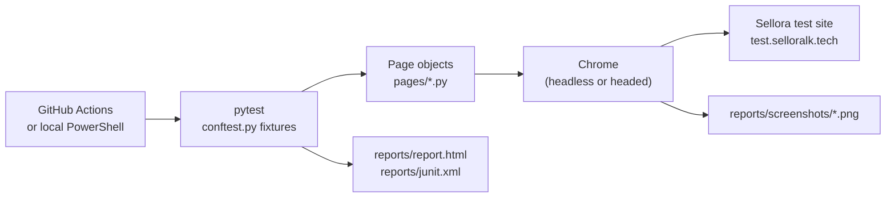
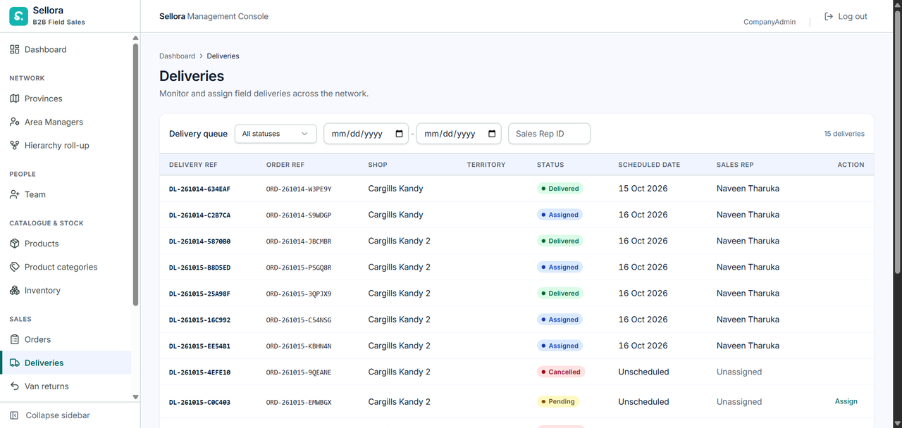
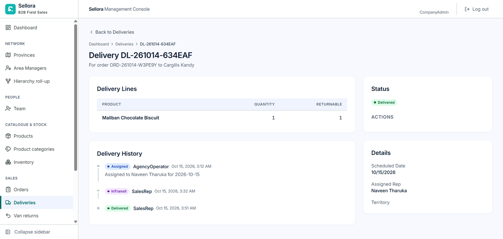
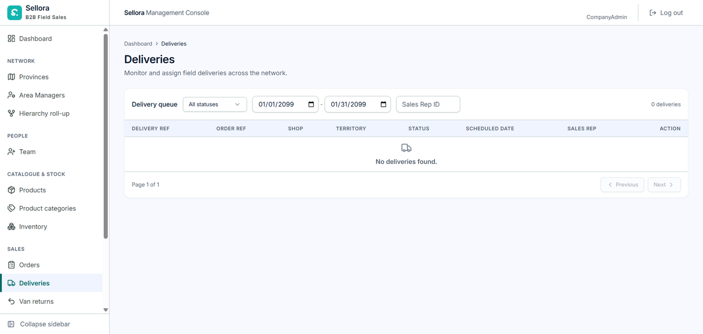
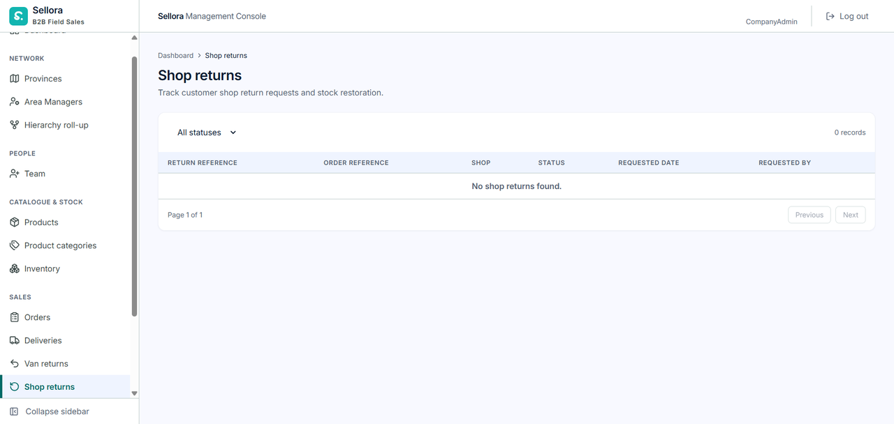

# Delivery UI Test Suite (Selenium)

Automated, read-only browser tests for the Delivery pages of the Sellora web app, run locally and in a GitHub Actions pipeline.

[](https://github.com/Team-Sellora/sellora-delivery/actions/workflows/selenium.yml?query=branch%3Atest%2Fselenium-delivery)

`Tests: 10/10 passing` · `Pipeline: passing` · `Python 3.12 (CI) / 3.14 (local)` · `Selenium 4.51` · `pytest 8.4` · `pytest-html 4.2`

---

## Contents

1. [Overview](#1-overview)
2. [Tech stack and design](#2-tech-stack-and-design)
3. [Project structure](#3-project-structure)
4. [Test cases](#4-test-cases)
5. [Results summary](#5-results-summary)
6. [Issues found and fixed](#6-issues-found-and-fixed)
7. [CI pipeline](#7-ci-pipeline)
8. [How to run locally](#8-how-to-run-locally)
9. [Evidence](#9-evidence)
10. [Limitations and next steps](#10-limitations-and-next-steps)

---

## 1. Overview

**What is tested.** The Delivery pages of the Sellora web app on the shared test site (`http://test.selloralk.tech`):

| Page | What the tests check |
|------|----------------------|
| Login and app shell | Sign-in through the identity server, sidebar with a *Deliveries* item |
| Deliveries list | Heading, breadcrumb, columns, rows or empty state, status / date / Sales Rep ID filters, paging |
| Delivery details | Opening a delivery, detail sections, *Back to Deliveries* |
| Shop returns | Heading, columns, status filter options, rows or empty state |

**Why UI tests.** The Delivery service already has back-end tests (`tests/Sellora.DeliveryService.Tests`). These UI tests check the same features end to end, the way a user sees them: the web app, the identity server login, the API gateway and the Delivery service working together in a real browser.

**Scope.**

- All tests are **read-only**. They open pages, apply filters and navigate, but never create, assign or change a delivery, so they are safe to run against the shared test site.
- Tests sign in with **a CompanyAdmin test account**. Filter tests skip themselves for roles that do not see the filters.
- **Van returns is out of scope.** That page calls the Order service, not the Delivery service.

---

## 2. Tech stack and design

| Item | Used for |
|------|----------|
| **Python** | Test language (3.12 in the pipeline, 3.14 locally) |
| **Selenium 4** | Drives Chrome. Selenium Manager downloads the matching driver, so no driver setup is needed |
| **pytest** | Test runner, fixtures and markers (`smoke`, `deliveries`, `filters`, `negative`, `paging`, `details`, `returns`) |
| **pytest-html** | Self-contained HTML report with a screenshot attached to every test |
| **Page Object Model** | Locators and page actions live in `pages/`; tests only call page methods and assert |
| **Explicit waits** | `WebDriverWait` everywhere (no `sleep`). Waits ignore stale elements, and reads are retried if React re-renders the page |
| **Headless Chrome** | Default mode (`HEADLESS=1`) at 1920x1080. Set `HEADLESS=0` to watch the browser |
| **Screenshots** | Taken after every test (passed or failed) and saved to `reports/screenshots/` |

### Test flow



Each test gets a fresh Chrome session from the `driver` fixture, signs in through `LoginPage`, and uses the page objects to reach and check its page. When the test ends, the fixture saves a screenshot and the report hook attaches it to the HTML report.

---

## 3. Project structure

```text
selenium-tests/
├── conftest.py                     # Chrome driver fixture, credentials from env vars, screenshot after every test
├── pytest.ini                      # test path, -v, HTML report options, marker list
├── requirements.txt                # selenium, pytest, pytest-html
├── test-cases.md                   # test case table: steps, expected and actual results
├── README.md                       # this testing report
├── .gitignore                      # ignores reports/, .venv/, caches
├── pages/
│   ├── __init__.py
│   ├── base_page.py                # shared waits, stale-safe reads, sidebar, heading, breadcrumb
│   ├── login_page.py               # identity server login with LOGIN_TIMEOUT and one retry
│   ├── deliveries_page.py          # Deliveries list: columns, rows, filters, count, paging
│   ├── delivery_detail_page.py     # one delivery: sections, Back to Deliveries
│   └── shop_returns_page.py        # Shop returns: columns, status filter, rows
├── tests/
│   ├── test_login.py               # TC-DEL-01
│   ├── test_deliveries_list.py     # TC-DEL-02 to TC-DEL-07
│   ├── test_delivery_details.py    # TC-DEL-08, TC-DEL-09
│   └── test_shop_returns.py        # TC-DEL-10
├── docs/
│   └── images/                     # screenshots used in this README
└── reports/                        # created by a run, not committed (report.html, junit.xml, screenshots/)
```

The workflow file is at the repository root: `.github/workflows/selenium.yml`.

---

## 4. Test cases

Full steps and expected results are in [test-cases.md](test-cases.md). Results and durations below are from the local run on 21 Oct 2026, 18:39 (`reports/junit.xml`).

| ID | Title | Type | Marker(s) | Result | Duration |
|----|-------|------|-----------|:------:|---------:|
| TC-DEL-01 | Login shows Deliveries in the sidebar | Functional | `smoke` | ✅ Pass | 13.720 s |
| TC-DEL-02 | Deliveries page opens | Navigation | `smoke`, `deliveries` | ✅ Pass | 17.926 s |
| TC-DEL-03 | List or empty state with columns | Functional | `deliveries` | ✅ Pass | 17.307 s |
| TC-DEL-04 | Status filter applies and resets | Functional | `filters` | ✅ Pass | 30.260 s |
| TC-DEL-05 | Date range and Sales Rep ID filters apply and reset | Functional | `filters` | ✅ Pass | 25.867 s |
| TC-DEL-06 | Filter with no match shows the empty state | Negative | `filters`, `negative` | ✅ Pass | 17.381 s |
| TC-DEL-07 | Paging controls | Navigation | `paging` | ✅ Pass | 14.328 s |
| TC-DEL-08 | Open one delivery shows details | Navigation | `details` | ✅ Pass | 16.293 s |
| TC-DEL-09 | Back returns to the Deliveries list | Navigation | `details` | ✅ Pass | 16.960 s |
| TC-DEL-10 | Shop returns page opens | Navigation | `returns` | ✅ Pass | 14.568 s |
| | **Total** | | | **10 / 10** | **184.884 s** |

Notes:

- Each duration includes starting Chrome and signing in, which is why every test takes at least about 14 s.
- pytest runs the files in alphabetical order, so `test_deliveries_list.py` (TC-DEL-02 to 07) runs before `test_login.py` (TC-DEL-01).

---

## 5. Results summary

### Local runs (Windows 11, Python 3.14.3, pytest 8.4.2, pytest-html 4.2.0, Selenium 4.51.0)

| Run | Started (21 Oct 2026, UTC+05:30) | Mode | Passed | Failed / errors | Total time |
|-----|----------------------------------|------|:------:|:---------------:|-----------:|
| 1 | 18:39 | Local run (Chrome) | 10 | 0 | 184.884 s |
| 2 | 19:20 | Headless | 10 | 0 | 230.371 s |
| 3 | 19:24 | Headless | 10 | 0 | 222.164 s |
| **All** | | | **30** | **0** | **637.419 s** |

**Local pass rate: 30 / 30 (100%).**

### Pipeline runs (GitHub Actions, ubuntu-latest, Python 3.12.15)

| Run | Commit | Started (21 Oct 2026, UTC+05:30) | Result | Tests |
|-----|--------|----------------------------------|--------|-------|
| [#39609320907](https://github.com/Team-Sellora/sellora-delivery/actions/runs/39609320907), attempt 1 | `a40c511` | 19:05 | ❌ Failed | None ran: `TEST_USER and TEST_PASSWORD environment variables must be set.` (exit code 2) |
| [#39609320907](https://github.com/Team-Sellora/sellora-delivery/actions/runs/39609320907), attempt 2 | `a40c511` | 19:14 | ❌ Failed | 8 passed, 2 errors (TC-DEL-06, TC-DEL-07) in 104.73 s |
| [#39612861087](https://github.com/Team-Sellora/sellora-delivery/actions/runs/39612861087) | `e68401d` | 19:29 | ✅ Passed | **10 passed in 95.30 s** |

- Attempt 1 failed because the two repository secrets had not been added yet. After adding them, the same run was re-run (attempt 2).
- Attempt 2 found the stale element problem described in [section 6](#6-issues-found-and-fixed).
- After the fix in `e68401d`, the pipeline passed with all 10 tests. **Latest pipeline pass rate: 10 / 10 (100%).**

---

## 6. Issues found and fixed

### Issue 1: Login timed out on the first local run

| | |
|---|---|
| **Symptom** | On the very first local run, the first test that ran (TC-DEL-02) timed out while logging in. Its screenshot was saved as `test_tc_del_02_deliveries_page_opens-failed.png`. |
| **Cause** | The screenshot shows a network filter page ("Intrusion Prevention - Access Blocked") for the test site instead of the login page, so the site was not reachable from that network at that moment. With a single attempt, one slow or blocked sign-in made the whole test fail. |
| **Fix** | Login was made more robust in `pages/login_page.py`: the login steps use their own longer timeout `LOGIN_TIMEOUT` (60 s by default, can be changed by environment variable); after submitting, the test waits for **either** the app sidebar **or** an identity server consent page and clicks through the consent page if shown; the whole login is **retried once** (`LOGIN_ATTEMPTS = 2`); and a timeout now names the step that failed and the current URL. |
| **Commit** | `395da1c` (test(delivery): add login page object and base page). The fix was made before the suite was first committed, so it is part of the commit that adds the login page object. |
| **Result** | All later runs (3 local, 2 pipeline runs with secrets) signed in successfully. |

### Issue 2: StaleElementReferenceException in the pipeline

| | |
|---|---|
| **Symptom** | Pipeline run #39609320907, attempt 2: 8 passed, **2 errors**. TC-DEL-06 and TC-DEL-07 errored during setup with `selenium.common.exceptions.StaleElementReferenceException: stale element reference: stale element not found in the current frame`. |
| **Cause** | The error came from `BasePage.wait_for_heading` (called by `DeliveriesPage.open()` in the `deliveries` fixture). The test found the page heading and then read its text, but React re-rendered the page in between, so the element it had found no longer existed. The same pattern (find, then read) was used in other page object methods. |
| **Fix** | The page objects now retry reads when React replaces an element: `WebDriverWait` ignores `StaleElementReferenceException`; a new `BasePage.read()` helper runs a read again if the element went stale; `text_of()` is built on it; and heading, breadcrumb, columns, rows, counts, filters, paging, detail sections and Shop returns reads all use it (4 files changed, 106 insertions, 48 deletions). No test or assertion was changed. |
| **Commit** | `e68401d` (test(delivery): retry stale element reads in page objects) |
| **Result** | Pipeline run #39612861087 on `e68401d`: **10 passed**. |

---

## 7. CI pipeline

Workflow: [`.github/workflows/selenium.yml`](../.github/workflows/selenium.yml) (name: *Selenium UI tests (Delivery)*).

**Triggers**

- Push to the `test/selenium-delivery` branch.
- Manual run (`workflow_dispatch`) from the Actions tab.

No other branches or pull requests trigger it.

**Job `selenium`** (ubuntu-latest, 20 minute timeout, working directory `selenium-tests`)

1. Check out the repository (`actions/checkout@v4`).
2. Set up Python 3.12 with pip caching (`actions/setup-python@v5`).
3. Install dependencies: `pip install -r requirements.txt`.
4. Run the tests: `pytest --html=reports/report.html --self-contained-html --junitxml=reports/junit.xml`.
5. Upload the `reports/` folder as an artifact (runs even if tests fail).

Chrome is already installed on the GitHub-hosted runner, and Selenium Manager provides the driver.

**Configuration**

| Variable | Source |
|----------|--------|
| `BASE_URL` | Set in the workflow: `http://test.selloralk.tech` |
| `TEST_USER` | Repository secret `SELLORA_TEST_USER` |
| `TEST_PASSWORD` | Repository secret `SELLORA_TEST_PASSWORD` |

Add the secrets under **Settings > Secrets and variables > Actions > New repository secret**. Without them the run stops at once with exit code 2.

**Downloading the report**

1. Open the **Actions** tab and select the *Selenium UI tests (Delivery)* run.
2. Under **Artifacts**, download **`selenium-delivery-report`**.
3. Unzip it and open `report.html` in a browser. It contains every test with its screenshot. `junit.xml` and `screenshots/` are in the same zip.

---

## 8. How to run locally

Requirements: Windows with Google Chrome and Python 3 installed. Run these commands in PowerShell from the repository root.

**1. Create a virtual environment and install packages**

```powershell
cd selenium-tests
py -m venv .venv
.\.venv\Scripts\Activate.ps1
pip install -r requirements.txt
```

**2. Set the environment variables** (use the CompanyAdmin test account; never commit real values)

```powershell
$env:TEST_USER = "<test user>"
$env:TEST_PASSWORD = "<test password>"
```

| Variable | Required | Default |
|----------|:--------:|---------|
| `TEST_USER` | yes | |
| `TEST_PASSWORD` | yes | |
| `BASE_URL` | no | `http://test.selloralk.tech` |
| `HEADLESS` | no | `1` (set `0` to see the browser) |
| `LOGIN_TIMEOUT` | no | `60` (seconds per login step) |

**3a. Headed run** (watch Chrome)

```powershell
$env:HEADLESS = "0"
pytest --junitxml=reports/junit.xml
```

**3b. Headless run**

```powershell
$env:HEADLESS = "1"
pytest --junitxml=reports/junit.xml
```

**Run part of the suite** by marker or by file:

```powershell
pytest -m smoke
pytest tests/test_delivery_details.py
```

**Output**

| File | Content |
|------|---------|
| `reports/report.html` | HTML report (always created, set in `pytest.ini`) with a screenshot for each test |
| `reports/junit.xml` | JUnit XML results (when `--junitxml` is given) |
| `reports/screenshots/` | One PNG per test, named `<test name>-passed.png` or `<test name>-failed.png` |

---

## 9. Evidence

Screenshots below were taken automatically by the suite during the local run on 21 Oct 2026. The signed-in account ID in the top bar has been hidden.

### Deliveries list (TC-DEL-03)



*The Deliveries list for a CompanyAdmin: the delivery queue with the status, date and Sales Rep ID filters, the delivery count and the eight agency columns.*

### Delivery details (TC-DEL-08)



*One delivery opened from the first row: breadcrumb, "Delivery DL-..." heading and the Delivery Lines, Delivery History, Status and Details sections.*

### Empty state, negative test (TC-DEL-06)



*A date range with no matching deliveries (01/01/2099 to 01/31/2099): no error, "No deliveries found.", 0 deliveries and "Page 1 of 1".*

### Shop returns (TC-DEL-10)



*The Shop returns page: heading, status filter, the six expected columns and the "No shop returns found." empty state.*

---

## 10. Limitations and next steps

**Limitations**

- **Shared test site and data.** The tests run against the shared test site and its current data. If the site is down, blocked by the network, or its data changes (for example the Deliveries list becomes empty), results change: TC-DEL-08 and TC-DEL-09 skip when there is no delivery to open, and TC-DEL-07 only checks Next/Previous when there is more than one page.
- **One role.** Only the CompanyAdmin view is tested. Sales rep and shop owner column sets are known to the page object but not exercised.
- **One browser.** Only Chrome is used.
- **Read-only.** Actions that change data (assigning a delivery, changing status, approving returns) are not tested, to keep the shared site clean.

**Next steps**

- Add role-based runs for the other roles (for example AreaManager, AgencyOperator, SalesRep, ShopOwner) with one test account each.
- Add cross-browser runs (Firefox, Edge) with a browser matrix in the workflow.
- Add write tests (assign a delivery, update status) against seeded test data that is reset after each run.
